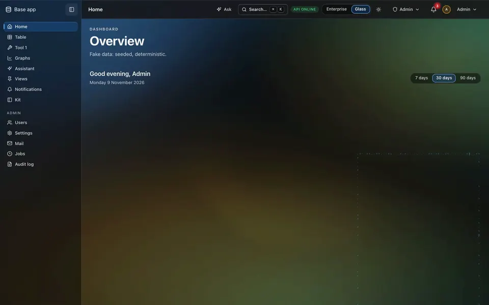
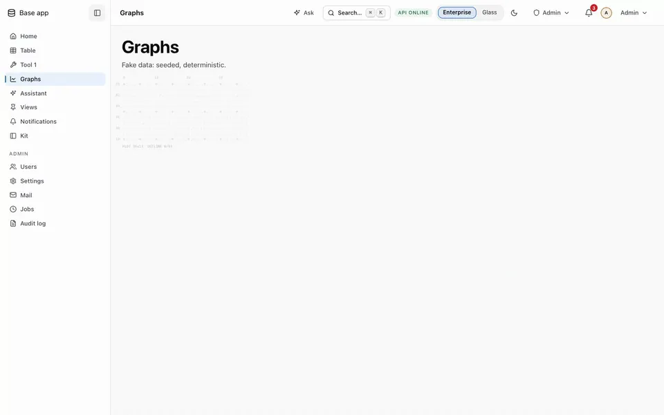
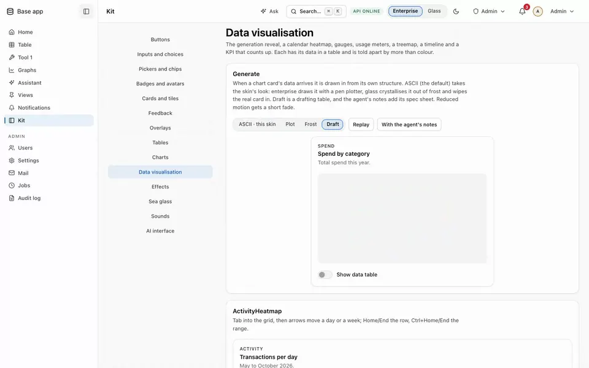
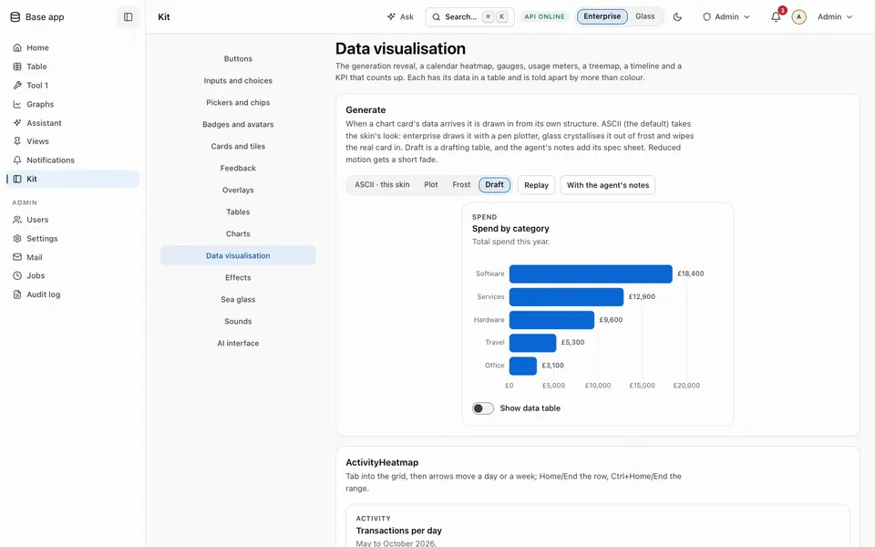
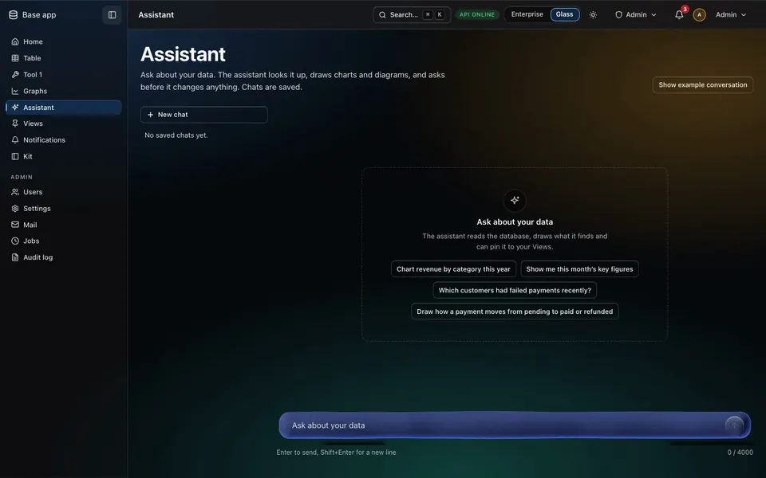
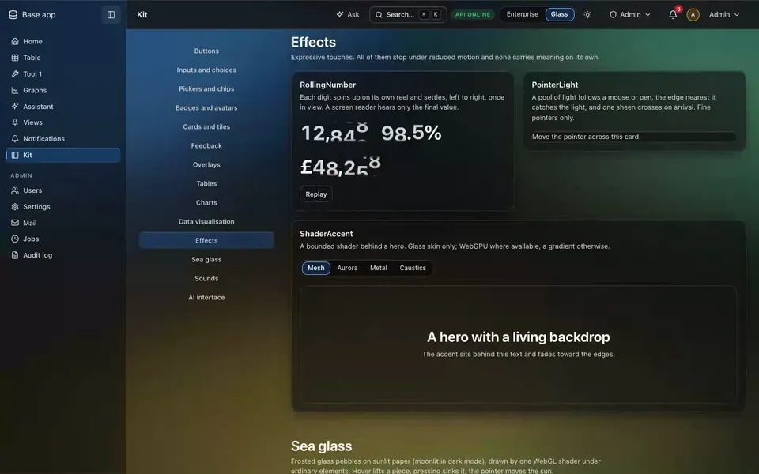
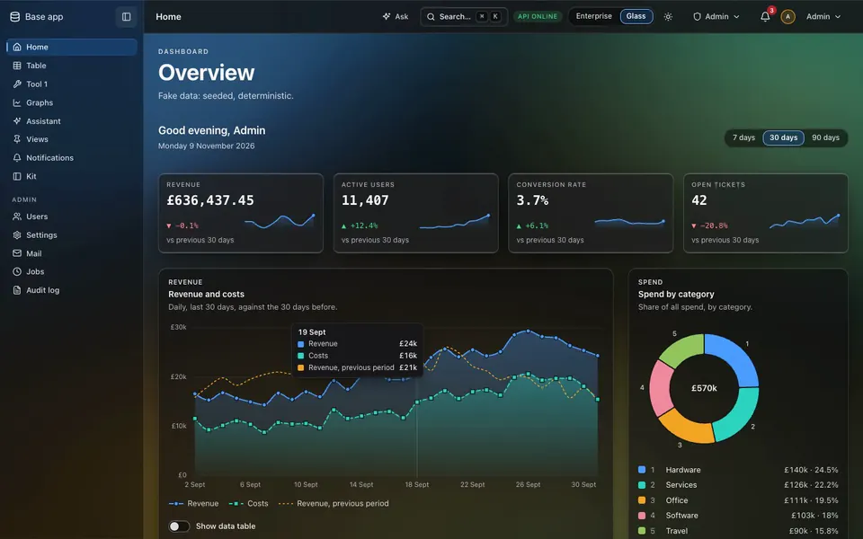
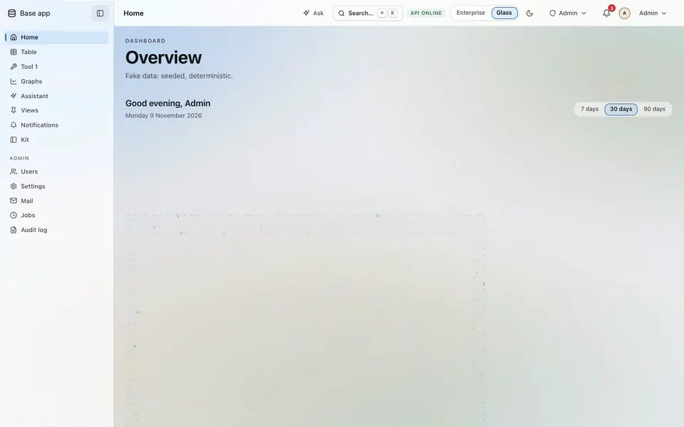

# Glasswork UI

**A React component kit with two skins, and a full-stack app template built on it.**
By [George Allan](https://github.com/George-595).

<table>
  <tr>
    <td width="50%"><a href="docs/demo/frost.webp"></a><br /><b>Frost.</b> Data arrives in the glass skin.</td>
    <td width="50%"><a href="docs/demo/plotter.webp"></a><br /><b>Pen plotter.</b> The same arrival in the enterprise skin.</td>
  </tr>
  <tr>
    <td><a href="docs/demo/draft.webp"></a><br /><b>Drafting table.</b> A card is drawn, then developed.</td>
    <td><a href="docs/demo/agent-notes.webp"></a><br /><b>The agent's notes.</b> Its spec sheet, written as it draws.</td>
  </tr>
  <tr>
    <td><a href="docs/demo/assistant.webp"></a><br /><b>The assistant.</b> It drafts, and asks before it acts.</td>
    <td><a href="docs/demo/odometer.webp"></a><br /><b>Odometer.</b> Each digit rolls in on its own reel.</td>
  </tr>
  <tr>
    <td><a href="docs/demo/pointer-light.webp"></a><br /><b>Pointer light.</b> Tiles catch the light as you pass.</td>
    <td><a href="docs/demo/frost-light.webp"></a><br /><b>Light mode.</b> Every effect works in all four themes.</td>
  </tr>
</table>

<a href="docs/demo/tour.mp4"><b>Watch the full tour</b></a> (93 seconds, both skins and both modes).

Glasswork is the UI I build my own apps with: an enterprise skin that stays calm and a glass skin
that uses a real liquid-glass material over a living backdrop, each in light and dark, every
colour a semantic role, every component checked against WCAG 2.2 AA in all four themes.

## What's in it

- **Two skins × two modes.** Enterprise (graphite and one azure accent) and glass (refractive
  liquid-glass surfaces over the kit's own `tide` and `hive` WebGL backdrops). Components never ask
  which skin is on: they use roles (`bg-surface`, `text-fg`), and `@apps/colors` gives every role
  a value per theme, with a contrast gate.
- **A generation reveal for data and AI.** When data arrives, a card is drawn in by a pen plotter
  (enterprise) or crystallises out of frost (glass). What an AI produced is drafted instead:
  construction lines, a pen walking every box, dimension lines, then the real card develops in.
- **Effects with manners.** An odometer for figures (`RollingNumber`), light that follows the
  pointer (`PointerLight`), frosted sea-glass pebbles: each one honours reduced motion, renders
  on demand and backs off on a device that lags.
- **Everything an app needs.** Shell, navigation, tables with sort and filter, forms, sheets,
  dialogs, toasts, charts with a table view, an assistant interface (messages, tool calls,
  approvals) and an account area.
- **A template to start from.** `base-app` is a working app: a React + Vite client rendered on the
  server, a Node API, SQLite / MySQL / Postgres, Anthropic and Gemini, sign-in, roles, an audit
  log, jobs and mail, and an assistant that acts through the same actions as the pages.

## Run it

```bash
npm install
npm run dev       # the base app on http://127.0.0.1:5173 (in-memory SQLite, no setup)
npm run verify    # biome + oxlint + colour/page/craft checks + 7-day dep quarantine
                  # + typecheck + tests + axe + bundle budget
```

Sign in with the public development login shown on the sign-in page. Open **Kit** in the sidebar
for every component in its states. To start an app of your own: `cd base-app && npm run export --
~/code/my-app` (see [`base-app/README.md`](base-app/README.md)).

| Path | What |
|---|---|
| [`packages/ui/`](packages/ui/README.md) | `@apps/ui`: the components, the two skins, light and dark |
| [`packages/colors/`](packages/colors/README.md) | `@apps/colors`: every colour, as roles per skin and mode, with the contrast gate |
| [`base-app/`](base-app/README.md) | the app template |
| [`ENGINEERING.md`](ENGINEERING.md) | the standards everything here is held to |

These documents were written inside my own monorepo, where this workspace is the `apps/` folder:
wherever they say `apps/`, read the repo root. Every dependency is an exact pin at least 7 days
old (`.npmrc`, `npm run check:deps`).

## Licence

Source-available under the [PolyForm Shield License 1.0.0](LICENSE.md). In plain English (the
licence text is what counts):

- **You can** read it, run it, change it and build your own apps and products with it, commercial
  ones included.
- **You can't** publish or sell it, or anything made from it, as a UI kit, component library,
  design system, template or starter of your own: that competes with it.

Parts adapted from other projects keep their own MIT and ISC licences; they are listed with their
notices in [`packages/ui/THIRD_PARTY_NOTICES.md`](packages/ui/THIRD_PARTY_NOTICES.md).

Required Notice: Copyright (c) 2026 George Allan (https://github.com/George-595)
